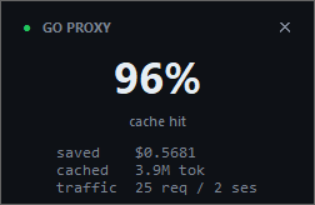

# OpenCode Go Proxy

Local shim + Windows tray app that makes third-party coding agents (ZCode,
Claude Code, Codex, …) work correctly against **OpenCode Go**, and keeps their
prompt cache warm so requests get ~30x cheaper.

> Unofficial community tool. Not affiliated with OpenCode.

## What it fixes

Third-party harnesses usually get three things wrong against the Go gateway:

| Symptom in the harness | Cause | What the proxy does |
|---|---|---|
| `400 MissingSessionID` | no session header sent | injects `x-opencode-session` |
| `401 requires an API key` → "Provider authentication failed" | auth header does not match the API shape | OpenAI paths get `Authorization: Bearer`, Anthropic paths get `x-api-key` |
| every request billed at full input price | session id changes per request, so prompt cache never hits | derives a stable id from `sha256(system + first user message)` |
| `404` | harness appends `/v1/...` to a base that already ends in `/v1` | collapses the duplicate segment |

Measured result on a real session: **cache hit 99–100%**, cost per request from
`~$0.0057` down to **`~$0.00018`** for the same ~39k-token context.

## Requirements

- **Node.js 18+** (uses global `fetch` and `Readable.fromWeb`; 20+ recommended)
- **Python 3.9+** with `pystray` and `pillow` — *only for the tray app*

```bash
pip install -r requirements.txt
```

The proxy itself is a single file with zero dependencies. The tray app is
Windows-only (uses `CREATE_NO_WINDOW`, `os.startfile`, Startup folder). On
macOS/Linux just run the `.mjs` directly.

## Quick start

### Windows tray

Double-click `start_tray.bat`, or:

```powershell
cd path\to\opencode-go-proxy
pythonw tray_app.py
```

A green **GO** icon appears in the system tray:

- `● Go proxy: RUNNING (tray) :17387` — status (non-clickable)
- `http://127.0.0.1:17387/v1` — the base URL to paste into your harness (non-clickable)
- **Copy base URL** — clipboard
- **Show stats overlay** / **Hide stats overlay** — the floating card described
  under [Measured savings](#measured-savings)
- **Auto-start with Windows: ON/OFF**
- **Proxy control** → **Live log...** (real-time log with session id + cache hit
  per request), run hidden / in a console window, Start / Stop proxy, Restart proxy
- **Open proxy folder** / **Quit**

### Plain Node (any OS)

```bash
node go-session-proxy.mjs
```

### Verify your key

```bash
node go-session-proxy.mjs --check oc_sk_xxxxxxxx
```

Sends one minimal request per API shape and prints the real error, so you can
tell a permission problem from a header problem:

```
OK   OpenAI  /chat/completions + Bearer -> 200
OK   Anthropic /messages      + x-api-key -> 200
```

## Point your harness at it

- **Base URL**: `http://127.0.0.1:17387/v1`
  (or `http://127.0.0.1:17387` if the harness appends `/v1/...` itself — both work)
- **API key**: a Console key whose permission is **`Models: Request`**.
  A key set to `Read` returns `403 This API key can't call models` even though
  it can list models.

> **The URL has to match the port the proxy actually bound.** If the preferred
> port was taken, the proxy walks up (see [Port selection](#port-selection)) and
> a harness still pointed at the old port talks to whatever else owns it: the
> proxy sees no traffic, the harness answers normally, and the cache never
> warms. Take the URL from the tray menu (**Copy base URL**) instead of typing it.

Key setup in the OpenCode Console:
`Account → Personal API keys → key → Edit… → Permissions → Restricted → Models: Request`

## Configuration

`config.json` (read by the tray app; edit then Restart from the tray menu):

```json
{
  "port": 17387,
  "port_scan": 20,
  "upstream": "https://opencode.ai/inference/go/v1",
  "session_mode": "conversation",
  "log_requests": true,
  "log_usage": true,
  "node_exe": "",
  "log_file": "logs/proxy.log"
}
```

| Field | Meaning |
|---|---|
| `port` | preferred port — bound to `127.0.0.1` only. `0` lets the OS pick a free one |
| `port_scan` | how many ports to try upward when `port` is busy (`0` = fail instead — see [the trade-off](#port-selection)) |
| `upstream` | Go base URL |
| `session_mode` | `conversation` (recommended) / `fixed` / `passthrough` |
| `log_requests` | sets `LOG=1` |
| `log_usage` | sets `USAGE=1` |
| `node_exe` | empty = auto-detect `node.exe` |
| `log_file` | where the proxy writes its log (default `logs/proxy.log`, rotated at 5 MB) |

When running the `.mjs` directly, the same options are environment variables:
`PORT`, `PORT_SCAN`, `UPSTREAM`, `SESSION_MODE`, `OPENCODE_SESSION`, `LOG`,
`USAGE`, `DUMP`, `PRICE_CACHE`, `PRICE_MISS`, `PRICE_OUT`.

The tray app reads only the fields listed above; the `PRICE_*` overrides have no
`config.json` equivalent yet and must be set in the environment.

### Port selection

The proxy never fails just because the default port is taken:

| `port` | Behaviour |
|---|---|
| `17387` (default) | binds 17387; if busy, walks up to 17388, 17389, … up to `port_scan` tries |
| `0` | the OS assigns a free port at random |
| any number | same fallback behaviour, starting from that number |

When the port differs from the preferred one, the proxy prints a
machine-readable line and a warning:

```
Port 17387 is busy, trying 17388...
Go proxy listening on http://127.0.0.1:17388/v1
RUNTIME_PORT=17388
  note: preferred port 17387 was busy; update your harness to the URL above
```

The tray app watches for `RUNTIME_PORT=` and shows the **real** URL in its menu,
so **Copy base URL** always copies the port the proxy actually bound.

**The trade-off.** Walking up is convenient, and silent. A harness still pointed
at the preferred port sends its requests to whatever else took that port: the
proxy log stays empty, the harness answers normally, and the prompt cache never
warms. When that is worse than a hard failure, set `port_scan` to `0` — the proxy
then exits with `EADDRINUSE` and the tray watchdog backs off instead of looping.

### Session modes

| Mode | Behaviour |
|---|---|
| `conversation` | id = hash of system + first user message. Stable across turns of one chat, different per chat. Overrides any client-sent id, because an id that changes per request is what kills cache affinity. Two chats that open with the same first message would collide, so if a conversation that was already several messages in suddenly presents a single message it gets a `_r1` id of its own. A single-message repeat is left alone, since that is a retry of the opening turn. |
| `fixed` | one id for every request |
| `passthrough` | never touch a session header the client sends |

## Reading the log

```
Go proxy listening on http://127.0.0.1:17387/v1
200 POST /chat/completions ses_44fb6d00b583751dddad82ef4c20c6c5 | msgs=39 sysLen=0 first="<system-reminder>..."
    usage ses_44fb6d00...: cache_read=38400 in=38859 out=76 hit=99%
```

| Field | Meaning | Price /1M |
|---|---|---|
| `cache_read` | context served from cache | $0.003 |
| `cache_miss` | newly written context | $0.15 |
| `out` | tokens the agent wrote | **$0.60** |

`hit%` should sit at 90–100% inside one conversation. If it is low:

```powershell
$env:DUMP="1"; $env:LOG="1"; node go-session-proxy.mjs
```

then compare two turns of the same chat:

- `msgs` should grow (history is being resent)
- `sysLen` must stay **constant** — if it changes, the harness injects
  something volatile (timestamp, git status, cwd) into the system prompt and
  nothing can cache it
- `first` must stay the same

Note that `out` is 200x the price of a cached read, so a turn where the agent
"thinks a lot" costs more regardless of cache. That is expected.

## Measured savings

`GET http://127.0.0.1:17387/__stats` returns running totals for this run, and the
proxy prints a summary line every 10 turns.

The tray app can put the same numbers on a small floating card
(**Show stats overlay**): always on top, drag it anywhere, double-click or hit
the ✕ to hide it. It only reads `/__stats`, so it never touches the API key or
the upstream. Numbers are per proxy run and start from zero after a restart.



```
  stats 10 req / 2 ses: hit=90% saved=~$0.001323
```

```json
{
  "requests": 10,
  "sessions": 2,
  "input_tokens": 10000,
  "cache_read_tokens": 9000,
  "cache_miss_tokens": 1000,
  "output_tokens": 500,
  "hit_pct": 90,
  "tokens_saved": 9000,
  "est_cost_usd": 0.000477,
  "est_cost_without_cache_usd": 0.0018,
  "est_saved_usd": 0.001323,
  "prices_per_1m": { "cache_read": 0.003, "cache_miss": 0.15, "output": 0.6 }
}
```

`tokens_saved` is the cached-read count: every one of those tokens was billed at
the cheap rate instead of the full input rate. The `est_*` costs are estimates
from the price table above — override them with `PRICE_CACHE`, `PRICE_MISS`,
`PRICE_OUT` (per 1M tokens) when your model is priced differently. Counters are
in memory and reset when the proxy restarts.

## Troubleshooting

| Error | Meaning | Fix |
|---|---|---|
| `400 MissingSessionID` | no session header reached the gateway | run through the proxy |
| `401 requires an API key` | key did not arrive in the header that path expects | let the proxy normalise it |
| `401 Invalid credential` | key rejected | typo, revoked, expired, or wrong workspace |
| `403 This API key can't call models` | key is scoped to `Models: Read` | set `Models: Request` |
| `EADDRINUSE` | another copy is already running, and `port_scan` is 0 | quit one, or raise `port_scan` |
| harness replies normally but `logs/proxy.log` stays empty | the harness points at a port the proxy is not on — the proxy moved, or something else owns that port | use **Copy base URL** from the tray, or set `port_scan` to `0` |

**Don't run two copies.** If the tray app is running, don't also start
`node go-session-proxy.mjs` in a terminal. With `port_scan` enabled the second
copy will silently bind the next free port and your harness will keep talking to
the first one, which is confusing. The tray watchdog backs off (3 → 6 → 9 … max
30 s) when starts keep failing.

## Security notes

- The proxy binds to **`127.0.0.1` only** and is not reachable from the network.
- It **never stores or logs the API key** — the key travels from the caller
  straight to the upstream.
- **`DUMP=1` logs the first 60 characters of your first user message.** It is a
  debugging aid; leave it off when sharing logs or recording your screen.
- Anyone with local access to the machine can send requests through the proxy,
  but only with their own key — nothing is privileged by going through it.

## Files

| File | Purpose |
|---|---|
| `go-session-proxy.mjs` | the proxy (Node, zero dependencies) |
| `tray_app.py` | Windows tray wrapper |
| `config.json` | settings |
| `start_tray.bat` / `start_console.bat` | launchers |
| `requirements.txt` | Python deps for the tray only |
| `logs/proxy.log` | proxy log, rotated at 5 MB (git-ignored) |

## License

MIT — see [LICENSE](LICENSE).
